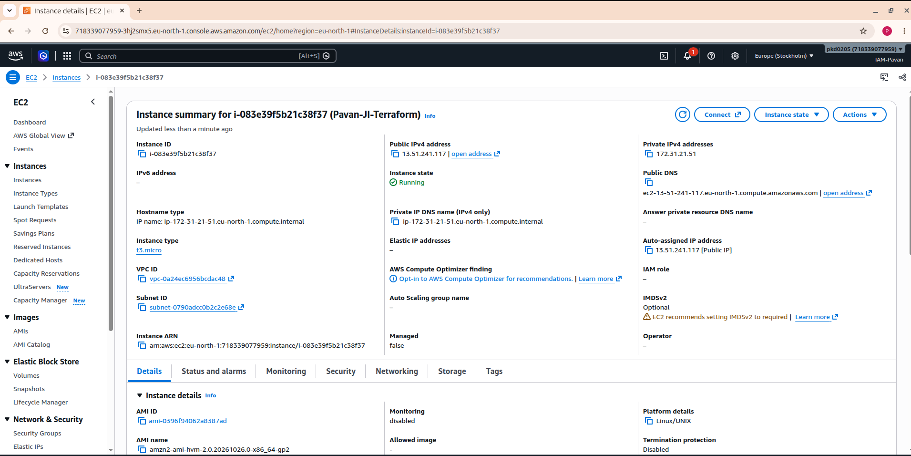

# Terraform Resource Guide: Create an AWS S3 Bucket and EC2 Instance

A beginner-friendly, step-by-step guide to understanding Terraform **resources**, **data sources**, **variables**, **dependencies**, and **outputs** while creating an Amazon S3 bucket and an Amazon EC2 instance.

> **Project goal:** Use Terraform to create an S3 bucket and an EC2 instance in AWS. Terraform will look up a suitable Amazon Linux 2 AMI, create the bucket, and then create the EC2 instance.

## Project overview

This project uses these Terraform building blocks:

| Component | Purpose in this project |
|---|---|
| AWS provider | Connects Terraform to AWS and selects the AWS region. |
| `data "aws_ami"` | Finds an existing Amazon Linux 2 machine image (AMI). It looks up information; it does not create an AMI. |
| `resource "aws_s3_bucket"` | Creates an S3 bucket. |
| `resource "aws_instance"` | Creates an EC2 virtual server. |
| Variables | Keep the region, instance type, instance name, and bucket name configurable. |
| `depends_on` | Tells Terraform to create the S3 bucket before creating the EC2 instance. |
| Output | Prints the S3 bucket name after Terraform applies the configuration. |

## Project structure

Keep the following files in the same project directory:

```text
.
├── main.tf
├── outputs.tf
├── variable.tf
├── Output.png
├── resource-guide.md
└── S3-Bucket.png
```

`Output.png` is the screenshot referenced in this guide. The `.gitignore` file is recommended so local state and other sensitive or generated files are not accidentally committed.

## 1. Understand the main configuration

Your `main.tf` contains the AWS provider, an AMI data source, and two resources.

### A. AWS provider

```hcl
provider "aws" {
  region = var.aws_region
}
```

**What is a provider?** A provider is a Terraform plugin that lets Terraform communicate with a platform such as AWS.

- `aws` selects the AWS provider.
- `region = var.aws_region` tells the provider which AWS region to use.
- The value comes from `variable.tf`, where the default region is `eu-north-1` (Europe/Stockholm).

Terraform needs valid AWS credentials as well as a region. This project expects credentials to be configured securely, for example with AWS CLI profiles or environment variables.

### B. AMI data source

```hcl
data "aws_ami" "amazon_linux" {
  most_recent = true
  owners      = ["amazon"]

  filter {
    name   = "name"
    values = ["amzn2-ami-hvm-*-x86_64-gp2"]
  }
}
```

**What is an AMI?** An Amazon Machine Image (AMI) is a template used to launch an EC2 instance. It contains the operating-system image and related launch information.

**What is a data source?** A data source reads information about something that already exists or is published by a provider. Unlike a `resource` block, it does not create the item it looks up.

- `most_recent = true` asks Terraform to choose the newest matching image.
- `owners = ["amazon"]` limits the lookup to images published by Amazon.
- `filter` narrows the search to names matching the specified Amazon Linux 2 pattern.
- `data.aws_ami.amazon_linux.id` refers to the AMI ID returned by this lookup.

**Important:** AMI availability and naming can change by region and over time. If the lookup returns no results, check the AMI filter and confirm that a matching Amazon Linux 2 AMI is available in your selected region.

### C. S3 bucket resource

```hcl
resource "aws_s3_bucket" "my_bucket" {
  bucket = var.bucket_name

  tags = {
    Name = "MyS3Bucket"
  }
}
```

**What is an S3 bucket?** Amazon S3 is object storage. A bucket is a container for objects such as files, images, backups, and logs.

- `resource "aws_s3_bucket"` declares an AWS S3 bucket resource.
- `my_bucket` is Terraform's local name for this resource. It is not the actual bucket name.
- `bucket = var.bucket_name` uses the configured bucket name from `variable.tf`.
- `tags` adds a label that helps identify the resource in AWS.

The current configured bucket name is `my-bucket-terraform-858553`. S3 bucket names must be globally unique across AWS. If this name is already taken, choose a different globally unique name in `variable.tf` before applying.

### D. EC2 instance resource

```hcl
resource "aws_instance" "my_ec2" {
  ami           = data.aws_ami.amazon_linux.id
  instance_type = var.instance_type

  tags = {
    Name = var.instance_name
  }

  depends_on = [
    aws_s3_bucket.my_bucket
  ]
}
```

**What is EC2?** Amazon Elastic Compute Cloud (EC2) provides virtual servers in AWS. You can use an EC2 instance to run applications, host websites, practise Linux administration, or deploy services.

- `resource "aws_instance"` declares an EC2 instance.
- `my_ec2` is the Terraform resource's local name.
- `ami` uses the AMI ID found by the data source.
- `instance_type` selects the compute size. This project defaults to `t3.micro`.
- `tags` assigns the instance a readable Name tag using `var.instance_name`.
- `depends_on` explicitly tells Terraform to create the S3 bucket before creating the EC2 instance.

**Why use `depends_on` here?** Terraform normally infers dependencies when one resource directly references another. In this configuration, the EC2 instance does not use an attribute from the bucket, so Terraform would not automatically know that the bucket must come first. `depends_on` establishes that ordering.

This is a learning example of an explicit dependency. In a real design, add a dependency only when the resources genuinely need that order.

**Networking note:** This configuration does not define a security group, key pair, or SSH access settings. Do not assume you can connect to the instance over SSH just because it was created. Secure networking and access must be configured separately if needed.

## 2. Understand the variables

Your `variable.tf` contains:

```hcl
variable "aws_region" {
  default = "eu-north-1"
}

variable "instance_type" {
  default = "t3.micro"
}

variable "instance_name" {
  default = "Pavan-JI-Terraform"
}

variable "bucket_name" {
  default = "my-bucket-terraform-858553"
}
```

Variables make configuration easier to reuse and update without editing the resource logic.

| Variable | Current default | Used for |
|---|---|---|
| `aws_region` | `eu-north-1` | AWS region |
| `instance_type` | `t3.micro` | EC2 instance size |
| `instance_name` | `Pavan-JI-Terraform` | EC2 Name tag |
| `bucket_name` | `my-bucket-terraform-858553` | Actual S3 bucket name |

For example, changing `instance_type` to another supported type changes the EC2 size on the next planned update. Check availability and pricing in your selected region before using a different type.

## 3. Understand the output

Your `outputs.tf` contains:

```hcl
output "bucket_name" {
  value = aws_s3_bucket.my_bucket.id
}
```

An output displays a value from the Terraform configuration after an operation.

- `output "bucket_name"` defines an output called `bucket_name`.
- `aws_s3_bucket.my_bucket.id` refers to the S3 bucket resource's ID. For this resource, the ID is the bucket name.
- This output **prints the bucket name only**. It does not print the EC2 public IP address.

To see the output later, run:

```bash
terraform output
```

To see only this output:

```bash
terraform output bucket_name
```

## 4. Configure AWS credentials securely

Terraform needs permission to create the S3 bucket and EC2 instance.

If you use the AWS CLI, first check that it is installed:

```bash
aws --version
```

Configure a profile if you have not already done so:

```bash
aws configure
```

Enter your AWS access key, secret key, default region, and output format when prompted. Use credentials belonging to an IAM identity with only the permissions required for this project. Never paste credentials into Terraform files, and never commit credentials or the local AWS credentials file to Git.

Confirm the identity Terraform will use:

```bash
aws sts get-caller-identity
```

If this command fails, fix the AWS CLI credentials or profile before continuing.

## 5. Run Terraform step by step

Open a terminal in the directory containing `main.tf`, `variable.tf`, and `outputs.tf`.

### Step 1 — Check the files

```bash
ls
```

Confirm that all three Terraform files are in the current directory.

### Step 2 — Initialize Terraform

```bash
terraform init
```

This downloads the required provider plugins and prepares the working directory. Run it when setting up the project or when provider/module configuration changes.

### Step 3 — Format the configuration

```bash
terraform fmt
```

This formats Terraform files consistently.

### Step 4 — Validate the configuration

```bash
terraform validate
```

This checks the configuration's syntax and internal consistency. It does not guarantee that AWS permissions, quotas, resource names, or AMI availability are correct.

### Step 5 — Review the execution plan

```bash
terraform plan
```

Read the plan carefully. It should show the S3 bucket and EC2 instance Terraform intends to create. Check the region, bucket name, instance type, and any estimated changes before proceeding.

### Step 6 — Create the resources

```bash
terraform apply
```

Review the plan again and type `yes` only if you approve the proposed changes. Terraform then creates the resources in AWS.

You can also run `terraform apply -auto-approve`, but beginners should normally review the plan and approve it interactively.

### Step 7 — Check the output

```bash
terraform output
```

Expected output will contain the bucket name, assuming the apply succeeded. The exact displayed value depends on the configured bucket name.

### Step 8 — Verify in AWS Console

1. Open the AWS Management Console.
2. Make sure the selected region is **Europe (Stockholm) — `eu-north-1`**.
3. Open **S3** and confirm that the bucket exists.
4. Open **EC2 → Instances** and confirm that the instance exists.
5. Check the EC2 instance's Name tag and instance type.

## 6. Project output screenshot

Place the screenshot file named `Output.png` in the same directory as this Markdown guide. GitHub will display it below when the file is committed to the repository with the same name and capitalization.



(S3-Bucket.png)

If the image does not display, confirm that `Output.png` is in the same folder as `resource-guide.md` and that its spelling and capitalization match exactly.

## 7. Useful Terraform commands

| Command | What it does |
|---|---|
| `terraform init` | Initializes the project and downloads providers. |
| `terraform fmt` | Formats Terraform configuration files. |
| `terraform validate` | Checks configuration syntax and consistency. |
| `terraform plan` | Previews proposed infrastructure changes. |
| `terraform apply` | Applies the approved changes to AWS. |
| `terraform output` | Displays configured output values. |
| `terraform show` | Displays the current state snapshot in a readable form. |
| `terraform state list` | Lists resources tracked in Terraform state. |
| `terraform destroy` | Plans to remove resources managed by this configuration. |

## 8. Common problems and fixes

### S3 bucket name is already in use

S3 bucket names are globally unique. Change `bucket_name` in `variable.tf` to a unique name, then review the plan before applying.

### AWS access denied

The AWS identity may not have sufficient permissions, or Terraform may be using a different profile than expected. Check:

```bash
aws sts get-caller-identity
```

Review IAM permissions and the selected AWS profile. Do not solve this by sharing root credentials or granting unrestricted permissions without a reason.

### No matching AMI found

The AMI filter may not match a currently available image in the selected region. Verify the filter, region, and availability of the Amazon Linux 2 image.

### Terraform reports that resources already exist

The resource may have been created outside this Terraform state, or the state file may be missing. Do not delete the state file or recreate resources blindly. Inspect the existing resources and Terraform state, then decide whether importing or safely reconciling the configuration is appropriate.

## 9. Cost and cleanup

AWS may charge for running EC2 instances, EBS storage, S3 storage, requests, data transfer, or other related services. `t3.micro` is not automatically free in every account or situation. Check current pricing and Free Tier eligibility for your account and region.

**When you have finished practising and no longer need the resources**, review what Terraform will remove:

```bash
terraform plan -destroy
```

If you are certain you want to delete the resources managed by this configuration, run:

```bash
terraform destroy
```

Read the plan and type `yes` to confirm. This removes the resources managed by this Terraform configuration, including the S3 bucket and EC2 instance. S3 bucket deletion can fail if the bucket contains objects; empty it first if you intend to remove it. Do not run destroy if you want to keep the resources.

## 10. Protect Terraform state

Terraform's `terraform.tfstate` file records information about managed infrastructure and can contain sensitive values.

- Do not commit `terraform.tfstate` or backup state files to a public GitHub repository.
- Add state files, `.terraform/`, and local variable files containing secrets to `.gitignore`.
- For team or production work, use a properly secured remote backend with state locking where supported.
- Treat plan files as potentially sensitive too.

Suggested `.gitignore` entries:

```gitignore
.terraform/
*.tfstate
*.tfstate.*
*.tfvars
*.tfplan
crash.log
```

Do not ignore `*.tfvars` if your project intentionally tracks a non-sensitive example file; never put secrets in a tracked file.

## 11. What you learned

After completing this project, you should be able to explain:

- The difference between a Terraform `resource` and a `data` source.
- How Terraform uses an AMI ID to launch an EC2 instance.
- How to create an S3 bucket with `aws_s3_bucket`.
- How variables make resource configuration reusable.
- How `depends_on` controls explicit resource ordering.
- How outputs display values from managed resources.
- How to initialize, validate, plan, apply, inspect, and destroy infrastructure safely.

## Final reminder

Always review `terraform plan` before applying changes, keep AWS credentials and Terraform state private, and check AWS pricing before leaving resources running.
